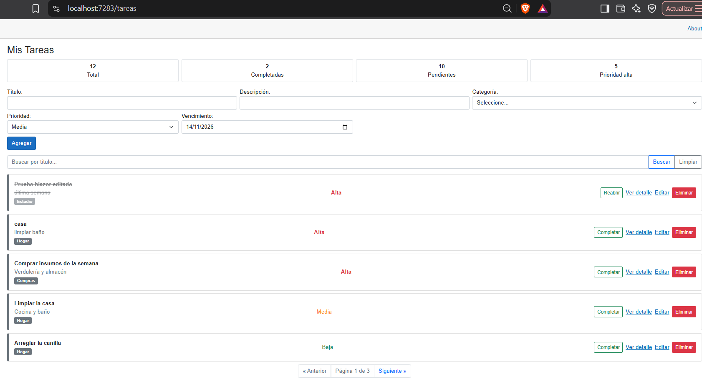
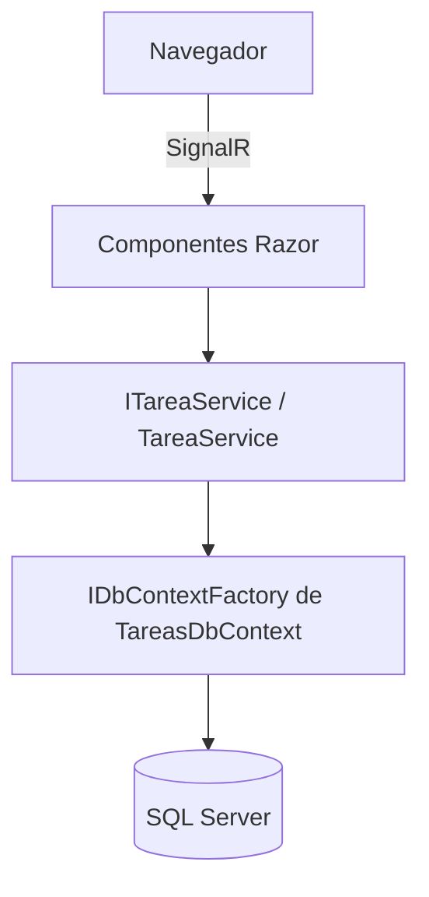

# Gestor de Tareas - Blazor

Aplicación web para gestionar tareas personales, construida con **Blazor Web App (.NET 8)** y **Entity Framework Core**. Es el Proyecto Integrador de la materia *Desarrollo Web con Blazor* (EDI) de la Tecnicatura Superior en Análisis, Desarrollo y Programación de Aplicaciones del ISFT N°93.



## Funcionalidades

- CRUD completo de tareas (crear, ver detalle, editar, eliminar).
- Categorías asociadas a cada tarea (relación uno-a-muchos).
- Marcar tareas como completadas o reabrirlas.
- Búsqueda por título y paginación contra la base de datos.
- Estadísticas en pantalla: total, completadas, pendientes y prioridad alta.
- Validaciones con Data Annotations, un atributo propio (`FechaFutura`) e `IValidatableObject`.
- Confirmación antes de eliminar mediante JS Interop.
- Manejo de errores visible en la interfaz, sin pantallas de error técnicas.

## Stack tecnológico

| Capa | Tecnología |
|------|------------|
| Interfaz | Blazor Web App .NET 8 (interactividad Server), Bootstrap 5, CSS Isolation |
| Lógica | Servicios con inyección de dependencias (`ITareaService`) |
| Datos | Entity Framework Core 8, SQL Server (LocalDB en desarrollo) |
| JavaScript | JS Interop con módulo en `wwwroot/js/confirmaciones.js` |
| Control de versiones | Git, GitHub, Git Flow, Conventional Commits |

## Arquitectura



## Estructura del proyecto

```
GestorTareas/
├── Components/
│   ├── Layout/        # MainLayout, NavMenu
│   ├── Pages/         # Home y páginas de la plantilla
│   └── Tareas/        # ListaTareas, DetalleTarea, EditarTarea y componentes reutilizables
├── Data/              # TareasDbContext
├── Migrations/        # Migraciones de EF Core
├── Models/            # Entidades, validaciones y DTOs
├── Services/          # ITareaService / TareaService
└── wwwroot/           # CSS, JS y archivos estáticos
```

## Instalación

Requisitos: [.NET 8 SDK](https://dotnet.microsoft.com/download/dotnet/8.0) y SQL Server LocalDB (viene con Visual Studio 2022).

```bash
git clone https://github.com/JaraClaudia/GestorTareas-Blazor.git
cd GestorTareas-Blazor/GestorTareas
dotnet restore
dotnet run
```

Al iniciar, la aplicación aplica las migraciones automáticamente y carga datos de ejemplo (5 categorías y 10 tareas), por lo que no hace falta ejecutar `dotnet ef database update`.

## Configuración

La cadena de conexión está en `appsettings.json` (clave `ConnectionStrings:Default`). En producción se define con la variable de entorno `ConnectionStrings__Default`; no se guardan credenciales en el repositorio.

## Flujo de trabajo

- Ramas: `main` (estable), `develop` (integración) y `feature/*` (cada funcionalidad).
- Cada cambio entra por Pull Request hacia `develop`.
- Mensajes de commit con [Conventional Commits](https://www.conventionalcommits.org/es/): `feat`, `fix`, `docs`, `refactor`, `style`, `test`, `chore`.
- Historias de usuario en [`docs/historias-de-usuario.md`](docs/historias-de-usuario.md).

## Próximas mejoras

- Filtro de tareas por prioridad.
- Modo oscuro con persistencia en localStorage.
- Notificaciones de tareas por vencer.
- Despliegue en Azure con GitHub Actions (CI/CD).

## Autora

Martinez Claudia - ISFT N°93, San Vicente, Buenos Aires.
