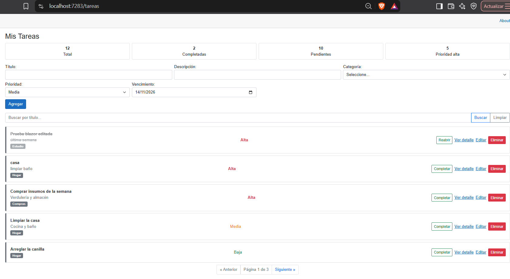
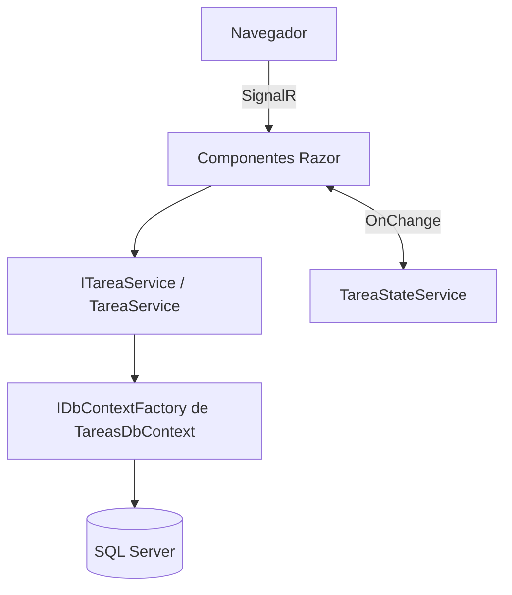

# Gestor de Tareas - Blazor

[](https://github.com/JaraClaudia/GestorTareas-Blazor/actions/workflows/ci.yml)

Aplicación web para gestionar tareas personales, construida con **Blazor Web App (.NET 8)** y **Entity Framework Core**. Es el Proyecto Integrador de la materia *Desarrollo Web con Blazor* (EDI) de la Tecnicatura Superior en Análisis, Desarrollo y Programación de Aplicaciones del ISFT N°93.

**Aplicación en línea:** [https://gestor-tareas-blazor.runasp.net/tareas](https://gestor-tareas-blazor.runasp.net/tareas)

> El hosting es gratuito: la primera carga después de un rato sin uso puede tardar unos segundos.



## Funcionalidades

- CRUD completo de tareas (crear, ver detalle, editar, eliminar).
- Categorías asociadas a cada tarea (relación uno-a-muchos).
- Marcar tareas como completadas o reabrirlas.
- Búsqueda por título y paginación contra la base de datos.
- Estadísticas en la pantalla de tareas: total, completadas, pendientes y prioridad alta pendiente.
- Estadísticas en el encabezado que se actualizan solas mediante un State Service con notificación reactiva.
- Validaciones con Data Annotations, un atributo propio (`FechaFutura`) e `IValidatableObject`.
- Confirmación antes de eliminar mediante JS Interop.
- Manejo de errores visible en la interfaz, sin pantallas de error técnicas.
- Endpoint de salud `/health` que verifica la conexión con la base de datos.
- Registro de operaciones con `ILogger` (niveles distintos por ambiente).

## Stack tecnológico

| Capa | Tecnología |
|------|------------|
| Interfaz | Blazor Web App .NET 8 (interactividad Server), Bootstrap 5, CSS Isolation, HTML5 semántico |
| Lógica | Servicios con inyección de dependencias (`ITareaService`, `TareaStateService`) |
| Datos | Entity Framework Core 8, SQL Server (LocalDB en desarrollo) |
| JavaScript | JS Interop con módulo en `wwwroot/js/confirmaciones.js` |
| Control de versiones | Git, GitHub, Git Flow, Conventional Commits |
| Integración continua | GitHub Actions (restore, build y publish en cada push y Pull Request) |
| Hosting | MonsterASP.NET (plan gratuito) con base de datos SQL Server |

## Arquitectura



`ListaTareas` guarda las estadísticas en `TareaStateService`, que dispara el evento `OnChange`. El componente `EstadisticasEncabezado`, suscripto a ese evento, se vuelve a dibujar con los datos nuevos.

## Estructura del proyecto

```
GestorTareas/
├── Components/
│   ├── Layout/        # MainLayout, NavMenu, EstadisticasEncabezado
│   ├── Pages/         # Página de inicio
│   └── Tareas/        # ListaTareas, DetalleTarea, EditarTarea y componentes reutilizables
├── Data/              # TareasDbContext
├── Migrations/        # Migraciones de EF Core
├── Models/            # Entidades, validaciones y DTOs
├── Services/          # ITareaService, TareaService, TareaStateService, health check
└── wwwroot/           # CSS, JS y archivos estáticos
```

## Instalación

Requisitos: [.NET 8 SDK](https://dotnet.microsoft.com/download/dotnet/8.0) y SQL Server LocalDB (viene con Visual Studio 2022).

```bash
git clone https://github.com/JaraClaudia/GestorTareas-Blazor.git
cd GestorTareas-Blazor/GestorTareas
dotnet restore
dotnet run
```

Al iniciar, la aplicación aplica las migraciones automáticamente y carga datos de ejemplo (5 categorías y 10 tareas), por lo que no hace falta ejecutar `dotnet ef database update`.

## Configuración

La cadena de conexión de desarrollo está en `appsettings.json` (clave `ConnectionStrings:Default`) y apunta a LocalDB.

En producción, `appsettings.Production.json` deja la conexión vacía a propósito y los valores reales se cargan como variables de entorno en el hosting, sin guardar credenciales en el repositorio:

| Variable | Descripción |
|----------|-------------|
| `ASPNETCORE_ENVIRONMENT` | `Production` |
| `ConnectionStrings__Default` | Cadena de conexión a SQL Server (el doble guion bajo reemplaza a los dos puntos) |

Para desarrollo también se pueden usar User Secrets (`dotnet user-secrets`).

## Despliegue

La aplicación se publica en MonsterASP.NET con Web Deploy desde Visual Studio. El workflow de GitHub Actions (`.github/workflows/ci.yml`) restaura, compila y publica el proyecto en cada push y Pull Request hacia `main` y `develop`. El despliegue automático desde el workflow todavía no está configurado.

## Flujo de trabajo

- Ramas: `main` (estable), `develop` (integración) y `feature/*` o `fix/*` (cada cambio).
- Cada cambio entra por Pull Request hacia `develop`.
- Mensajes de commit con [Conventional Commits](https://www.conventionalcommits.org/es/): `feat`, `fix`, `docs`, `refactor`, `style`, `test`, `chore`, `ci`.
- Historias de usuario en [`docs/historias-de-usuario.md`](docs/historias-de-usuario.md).
- Historial de versiones en [`CHANGELOG.md`](CHANGELOG.md).

## Próximas mejoras

- Filtro de tareas por prioridad.
- Modo oscuro con persistencia en localStorage.
- Notificaciones de tareas por vencer.
- Despliegue automático desde GitHub Actions.

## Autora

Martinez Claudia - ISFT N°93, San Vicente, Buenos Aires.
